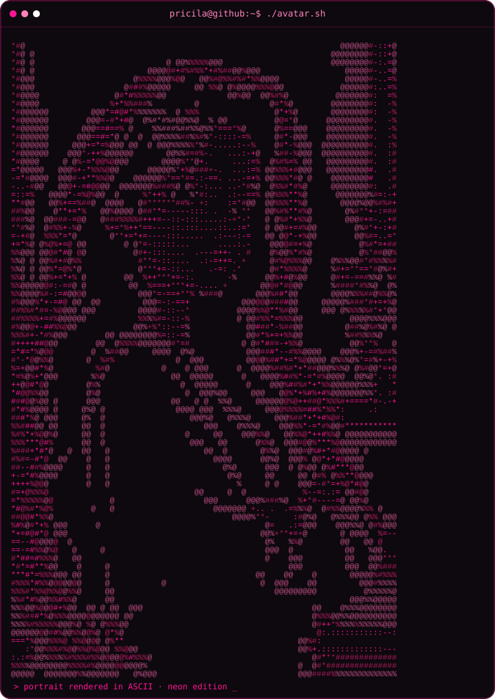

<h3><code>pricila@github ~ $ whoami</code></h3>

  
  

  
  
  

 

<h3><code>pricila@github ~ $ ./contributions.sh</code></h3>

  

<code>pricila@github ~ $ cat stack.md</code>

 

| Area | Technologies |
|:--|:--|
| **Languages** | PHP · JavaScript · Python (learning) · SQL |
| **Backend & integrations** | REST APIs · TOTVS Datasul · ExecBO · Corporate systems |
| **Frontend** | Vue · Bootstrap · jQuery · HTML · CSS |
| **Databases** | MySQL · SQL Server |
| **Data & AI studies** | NumPy · Matplotlib · Machine Learning fundamentals |
| **Tools** | Git · GitHub · PowerShell |

 

<code>currently exploring: Python backend • software architecture • artificial intelligence</code>

